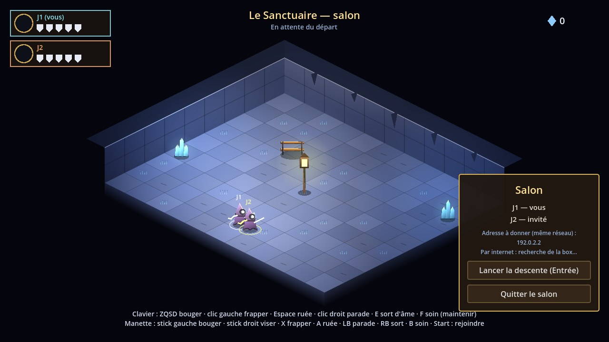
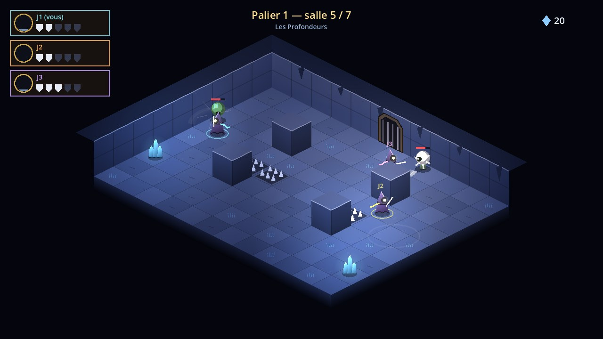
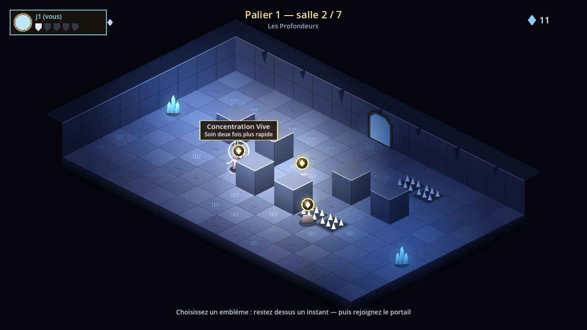
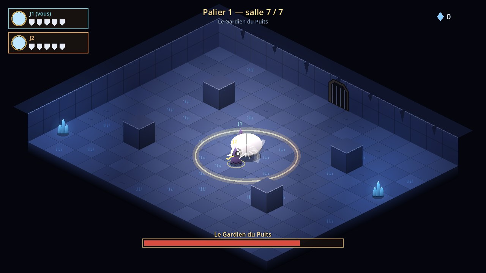

# La Ronde des Veilleurs (The Watchers' Round)

*[Version française](README.md)*

A **co-op** isometric roguelite for **Godot 4.3**, set in the world of
[Lanterne des Profondeurs](https://github.com/FlyinnRabbit/lanterne-des-profondeurs):
1 to 4 Watchers descend together, room after room, down to the Warden of the Well.
Online (one player hosts, the others join) or several players on one screen.
Everything is drawn in code, with no image assets.

| | |
|---|---|
|  |  |
|  |  |

## Status (v0.1)
First playable version: one full tier in the Depths. The game text is in French for now.
- **7 rooms**: three fights, a rest stop (full heal), two fights, then the **Warden of the Well**.
- **4 enemies**: crawler, flyer (telegraphed dive), spitter (spores), guard (frontal shield).
- **Combat**: needle (3-hit combo), dash, parry, soul spell, heal.
- **8 charms**: after each fight three pedestals appear and each Watcher picks one.
- **Co-op**: a downed Watcher gets back up if an ally stays close; the run ends when everyone is
  down. Enemies are more numerous and tougher with more players.

## Playing together

### Online
1. One player picks **Héberger une partie en ligne** (host). The lobby shows the address to share.
2. The others pick **Rejoindre une partie en ligne** (join) and type that address.
3. The host starts the descent (button, Enter key, or Select/View on a gamepad).

- **Same network**: the local address shown (192.168.x.x) is enough.
- **Over the internet**: the game tries to open the port by itself (UPnP) and then shows the public
  address. If the router refuses, either forward **UDP port 24565** to the host's PC, or use a
  free private network such as Tailscale or ZeroTier.
- Everyone needs the same game version. If the host leaves, the game ends for everyone.

### Same screen
Start **Jouer seul**, then in the lobby each extra gamepad presses **Start** to join.
The first player keeps the keyboard and mouse.

## Controls

| Action | Keyboard / mouse | Gamepad |
|---|---|---|
| Move | W A S D / arrows | left stick / D-pad |
| Aim | mouse | right stick (otherwise: movement direction) |
| Attack (3-hit combo) | left click or J | X |
| Dash (passes through enemies, shots and spikes) | Space or Shift | A or RT |
| Parry (stuns, reflects spores) | right click or K | LB or LT |
| Soul spell (33 soul) | E or O | RB or Y |
| Heal (hold, 33 soul) | F or L | B |
| Pause / menu | Esc | — |
| Full screen | F11 | — |

## License
Code, music and sound effects: **MIT** license — see `LICENSE`.
Inspired by Hollow Knight (Team Cherry) but reuses none of its characters or assets.
