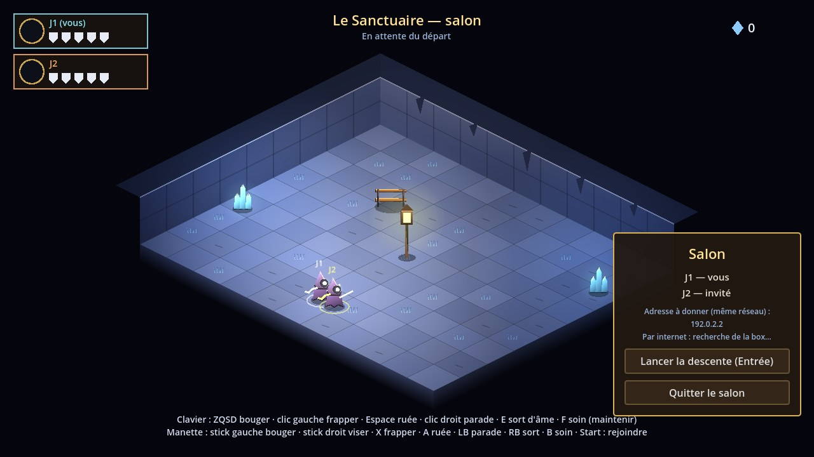
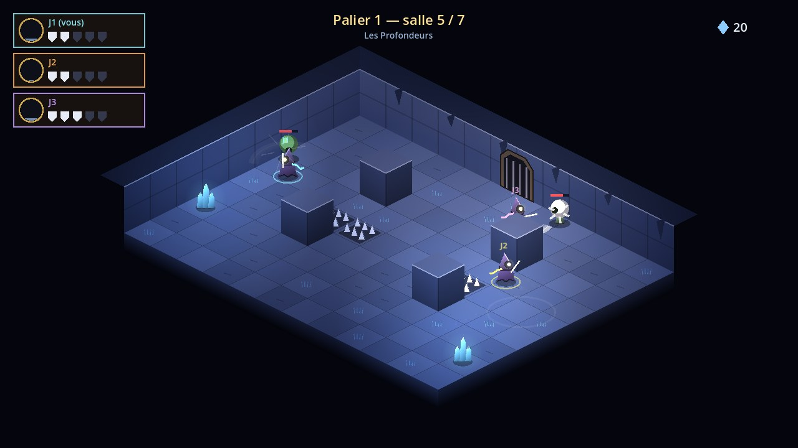
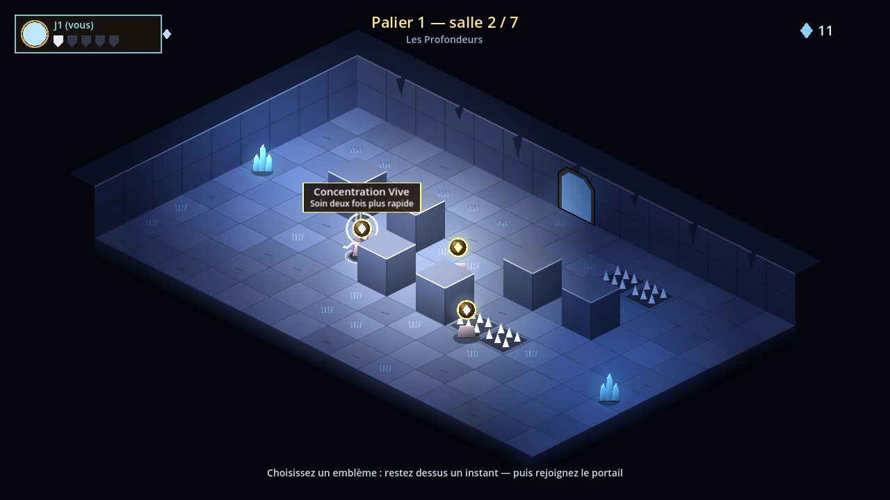
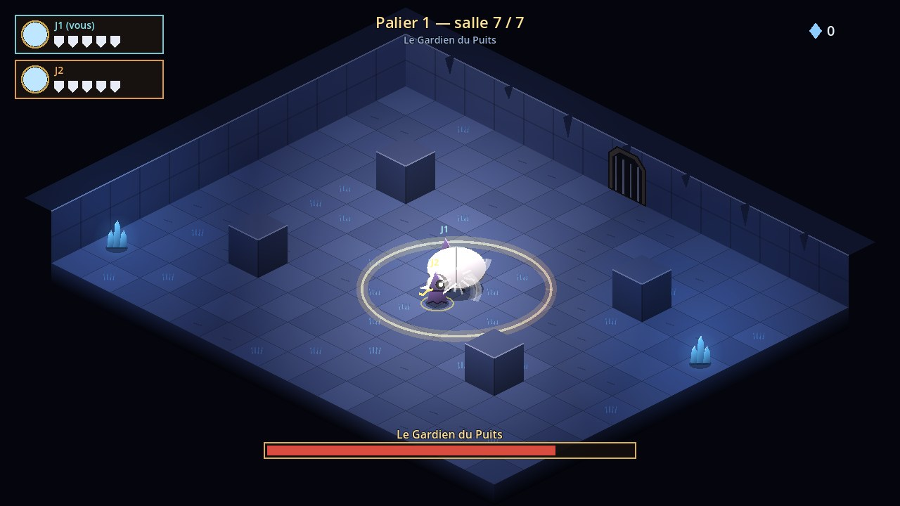

# La Ronde des Veilleurs

*[English version](README.en.md)*

Roguelite **coopératif** en vue isométrique pour **Godot 4.3**, dans l'univers de
[Lanterne des Profondeurs](https://github.com/FlyinnRabbit/lanterne-des-profondeurs) :
1 à 4 Veilleurs descendent ensemble, salle après salle, jusqu'au Gardien du Puits.
En ligne (un joueur héberge, les autres le rejoignent) ou à plusieurs sur le même écran.
Tout est dessiné en code, sans aucune image.

| | |
|---|---|
|  |  |
|  |  |

## État du jeu (v0.1)
Première version jouable : un palier complet dans les Profondeurs.
- **7 salles** : trois combats, une halte (soin complet), deux combats, puis le **Gardien du Puits**.
- **4 ennemis** : rampant, volant (piqué annoncé), cracheur (spores), garde (bouclier de face).
- **Combat** : aiguille (combo de 3 coups), Ruée, parade, sort d'âme, soin.
- **8 emblèmes** : après chaque combat, trois socles apparaissent et chaque Veilleur en choisit un.
- **Coop** : un Veilleur à terre se relève si un allié reste près de lui ; la ronde s'achève quand
  tout le monde est à terre. Les ennemis sont plus nombreux et plus solides à plusieurs.

À venir : les autres biomes et boss, le Sanctuaire (marchand, arsenal), les armes, les paliers sans fin.

## Télécharger
Onglet **Releases** : Windows, Linux / Steam Deck, macOS. Les exécutables ne sont pas signés
(Windows : *Informations complémentaires → Exécuter quand même* ; macOS : *clic droit → Ouvrir*).
**Tous les joueurs doivent avoir la même version.**

## Jouer à plusieurs

### En ligne
1. Un joueur choisit **Héberger une partie en ligne**. Son salon affiche l'adresse à donner.
2. Les autres choisissent **Rejoindre une partie en ligne** et tapent cette adresse.
3. L'hôte lance la descente (bouton, touche Entrée, ou Select/View à la manette).

- **Même réseau (même box)** : l'adresse locale affichée (192.168.x.x) suffit.
- **Par internet** : le jeu essaie d'ouvrir le port tout seul (UPnP) et affiche alors l'adresse
  publique à donner. Si la box refuse, il faut soit rediriger le **port UDP 24565** vers le PC de
  l'hôte, soit utiliser un réseau privé gratuit comme Tailscale ou ZeroTier (chacun l'installe,
  puis on utilise l'adresse que l'outil donne à l'hôte).
- Si l'hôte quitte, la partie s'arrête pour tout le monde.

### Sur le même écran
Lancer **Jouer seul**, puis au salon chaque manette supplémentaire appuie sur **Start** pour
rejoindre. Le premier joueur garde le clavier et la souris. On peut mélanger : deux joueurs sur un
PC qui héberge, un troisième en ligne.

## Commandes

| Action | Clavier / souris | Manette |
|---|---|---|
| Bouger | Z Q S D (ou W A S D) / flèches | stick gauche / croix |
| Viser | souris | stick droit (sinon : direction du déplacement) |
| Frapper (combo de 3) | clic gauche ou J | X |
| Ruée (traverse ennemis, tirs et pics) | Espace ou Maj | A ou RT |
| Parade (étourdit, renvoie les spores) | clic droit ou K | LB ou LT |
| Sort d'âme (33 d'âme) | E ou O | RB ou Y |
| Soin (maintenir, 33 d'âme) | F ou L | B |
| Pause / menu | Échap | — |
| Plein écran | F11 | — |

## Emblèmes
| Emblème | Effet |
|---|---|
| Aiguille Longue | portée des coups +35 % |
| Cœur de Verre | +2 masques de vie |
| Cape Rapide | course +12 %, Ruée plus fréquente |
| Coquille Épineuse | blesse les ennemis proches quand on est touché |
| Miroir Parfait | parade presque deux fois plus longue |
| Âme Vorace | +60 % d'âme à chaque coup |
| Concentration Vive | soin deux fois plus rapide |
| Force Brute | +1 dégât, coups un peu plus lents |

## Développement
Ouvrir le dossier dans Godot 4.3 (version standard) et appuyer sur F5.

Fonctionnement du réseau (`scripts/game.gd`) : l'hôte fait tourner les ennemis, les dégâts et la
progression, et envoie l'état du monde 20 fois par seconde ; chaque joueur décide de la position
de son propre Veilleur et l'envoie 30 fois par seconde.

Tests automatiques (des pilotes automatiques jouent à la place des joueurs) :
```
godot --headless --fixed-fps 60 -- --solo --bot --autostart 1 --quit-after-run --debug-log
godot --headless --fixed-fps 60 -- --host --bot --autostart 2 --quit-after-run --debug-log
godot --headless --fixed-fps 60 -- --join 127.0.0.1 --bot --quit-after-run --debug-log
```
Autres options de test : `--god` (pas de dégâts), `--room N` (salle de départ), `--shots préfixe`
(captures d'écran périodiques).

## Licence
Code, musiques et bruitages : licence **MIT** — voir `LICENSE`.
Le jeu s'inspire de Hollow Knight (Team Cherry) mais n'en réutilise ni personnages ni ressources.
